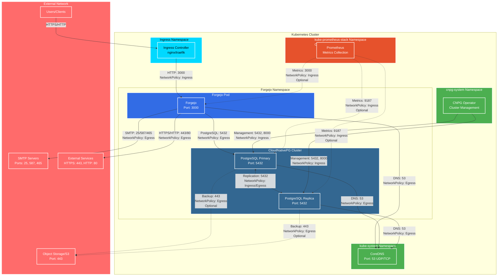

<!--- app-name: Forgejo -->

# Forgejo

Forgejo is a lightweight code hosting solution. Written in Go, features low resource consumption, easy upgrades and multiple databases.

[Overview of Forgejo](https://forgejo.org/)

Trademarks: This software listing is packaged by Bitnami. The respective trademarks mentioned in the offering are owned by the respective companies, and use of them does not imply any affiliation or endorsement.

## Architecture

The following diagram illustrates the forgejo Helm chart architecture with network flows when NetworkPolicies are enabled:



### Network Flow Legend

- **Solid lines**: Required network flows
- **Dashed lines**: Optional network flows (configurable)
- **NetworkPolicy labels**: Indicate which NetworkPolicy rule controls the flow

### Key Components

1. **Forgejo Application**
   - Receives traffic from Ingress Controller on port 3000
   - Connects to PostgreSQL database on port 5432
   - Sends emails via SMTP servers
   - Accesses external services for push notifications and updates

2. **CloudNativePG Cluster**
   - Managed by CNPG operator
   - Supports high availability with primary/replica instances
   - Replication between instances on port 5432
   - Optional backup to Object Storage (S3-compatible)

3. **Network Policies**
   - Control ingress and egress traffic for both forgejo and PostgreSQL
   - Disabled by default for compatibility
   - Enable with `networkPolicy.forgejo.enabled` and `networkPolicy.postgresql.enabled`

4. **Monitoring (Optional)**
   - Prometheus can scrape metrics from both forgejo and PostgreSQL
   - Requires enabling monitoring in NetworkPolicy configuration

## Install Forgejo

### Install CloudNativePG Operator

```bash
# Add CNPG Helm repository
helm repo add cnpg oci://ghcr.io/cloudnative-pg/charts/cloudnative-pg

# Install CNPG operator
helm install cnpg cnpg/cloudnative-pg \
  --namespace cnpg-system \
  --create-namespace \
  --version 0.28.2

# Verify operator installation
kubectl get pods -n cnpg-system
```

### Install Cert-manager (Optional but Recommended)

```bash
# Add cert-manager repository
helm repo add jetstack oci://quay.io/jetstack/charts/cert-manager

# Install cert-manager
helm install cert-manager jetstack/cert-manager \
  --namespace cert-manager \
  --create-namespace \
  --version v1.20.2 \
  --set installCRDs=true
```

## Parameters

### Global parameters

| Name                      | Description                                     | Value |
| ------------------------- | ----------------------------------------------- | ----- |
| `global.imageRegistry`    | Global Docker image registry                    | `""`  |
| `global.imagePullSecrets` | Global Docker registry secret names as an array | `[]`  |
| `global.storageClass`     | Global StorageClass for Persistent Volume(s)    | `""`  |

### Common parameters

| Name                | Description                                                                                                 | Value           |
| ------------------- | ----------------------------------------------------------------------------------------------------------- | --------------- |
| `kubeVersion`       | Force target Kubernetes version (using Helm capabilities if not set)                                        | `""`            |
| `nameOverride`      | String to partially override forgejo.fullname template (will maintain the release name)                     | `""`            |
| `fullnameOverride`  | String to fully override forgejo.fullname template                                                          | `""`            |
| `namespaceOverride` | String to fully override common.names.namespace                                                             | `""`            |
| `commonAnnotations` | Common annotations to add to all Forgejo resources (sub-charts are not considered). Evaluated as a template | `{}`            |
| `commonLabels`      | Common labels to add to all Forgejo resources (sub-charts are not considered). Evaluated as a template      | `{}`            |
| `clusterDomain`     | Default Kubernetes cluster domain                                                                           | `cluster.local` |
| `extraDeploy`       | Array of extra objects to deploy with the release (evaluated as a template).                                | `[]`            |

### Forgejo parameters

| Name                                                | Description                                                                                                                                                                                                | Value                     |
| --------------------------------------------------- | ---------------------------------------------------------------------------------------------------------------------------------------------------------------------------------------------------------- | ------------------------- |
| `diagnosticMode.enabled`                            | Enable diagnostic mode (all probes will be disabled and the command will be overridden)                                                                                                                    | `false`                   |
| `diagnosticMode.command`                            | Command to override all containers in the chart release                                                                                                                                                    | `["sleep"]`               |
| `diagnosticMode.args`                               | Args to override all containers in the chart release                                                                                                                                                       | `["infinity"]`            |
| `image.registry`                                    | Forgejo image registry                                                                                                                                                                                     | `REGISTRY_NAME`           |
| `image.repository`                                  | Forgejo Image name                                                                                                                                                                                         | `REPOSITORY_NAME/forgejo` |
| `image.digest`                                      | Forgejo image digest in the way sha256:aa.... Please note this parameter, if set, will override the tag                                                                                                    | `""`                      |
| `image.pullPolicy`                                  | Forgejo image pull policy                                                                                                                                                                                  | `IfNotPresent`            |
| `image.pullSecrets`                                 | Specify docker-registry secret names as an array                                                                                                                                                           | `[]`                      |
| `appName`                                           | Forgejo application name                                                                                                                                                                                   | `example`                 |
| `runMode`                                           | Forgejo application host                                                                                                                                                                                   | `prod`                    |
| `rootURL`                                           | UI Root URL (for link generation)                                                                                                                                                                          | `""`                      |
| `enableReverseProxyAuthentication`                  | Enable reverse proxy authentication (for reverse proxy setups)                                                                                                                                             | `false`                   |
| `trustedProxies`                                    | Comma-separated list of trusted proxies (for reverse proxy setups)                                                                                                                                         | `10.0.0.0/8`              |
| `command`                                           | Override default container command (useful when using custom images)                                                                                                                                       | `[]`                      |
| `args`                                              | Override default container args (useful when using custom images)                                                                                                                                          | `[]`                      |
| `updateStrategy.type`                               | Update strategy - only really applicable for deployments with RWO PVs attached                                                                                                                             | `Recreate`                |
| `replicaCount`                                      | Number of Forgejo replicas to deploy                                                                                                                                                                       | `1`                       |
| `priorityClassName`                                 | Forgejo pods' priorityClassName                                                                                                                                                                            | `""`                      |
| `schedulerName`                                     | Name of the k8s scheduler (other than default)                                                                                                                                                             | `""`                      |
| `topologySpreadConstraints`                         | Topology Spread Constraints for pod assignment                                                                                                                                                             | `[]`                      |
| `automountServiceAccountToken`                      | Mount Service Account token in pod                                                                                                                                                                         | `false`                   |
| `hostAliases`                                       | Add deployment host aliases                                                                                                                                                                                | `[]`                      |
| `extraEnvVars`                                      | Extra environment variables                                                                                                                                                                                | `[]`                      |
| `extraEnvVarsCM`                                    | ConfigMap containing extra env vars                                                                                                                                                                        | `""`                      |
| `extraEnvVarsSecret`                                | Secret containing extra env vars (in case of sensitive data)                                                                                                                                               | `""`                      |
| `extraVolumes`                                      | Array of extra volumes to be added to the deployment (evaluated as template). Requires setting `extraVolumeMounts`                                                                                         | `[]`                      |
| `extraVolumeMounts`                                 | Array of extra volume mounts to be added to the container (evaluated as template). Normally used with `extraVolumes`.                                                                                      | `[]`                      |
| `initContainers`                                    | Add additional init containers to the pod (evaluated as a template)                                                                                                                                        | `[]`                      |
| `sidecars`                                          | Attach additional containers to the pod (evaluated as a template)                                                                                                                                          | `[]`                      |
| `tolerations`                                       | Tolerations for pod assignment                                                                                                                                                                             | `[]`                      |
| `existingSecret`                                    | Name of a secret with the application password                                                                                                                                                             | `""`                      |
| `containerPorts`                                    | Container ports                                                                                                                                                                                            | `{}`                      |
| `persistence.enabled`                               | Enable persistence using PVC                                                                                                                                                                               | `true`                    |
| `persistence.storageClass`                          | PVC Storage Class for Forgejo volume                                                                                                                                                                       | `""`                      |
| `persistence.accessModes`                           | PVC Access Mode for Forgejo volume                                                                                                                                                                         | `["ReadWriteOnce"]`       |
| `persistence.size`                                  | PVC Storage Request for Forgejo volume                                                                                                                                                                     | `8Gi`                     |
| `persistence.dataSource`                            | Custom PVC data source                                                                                                                                                                                     | `{}`                      |
| `persistence.existingClaim`                         | A manually managed Persistent Volume Claim                                                                                                                                                                 | `""`                      |
| `persistence.hostPath`                              | If defined, the forgejo-data volume will mount to the specified hostPath.                                                                                                                                  | `""`                      |
| `persistence.annotations`                           | Persistent Volume Claim annotations                                                                                                                                                                        | `{}`                      |
| `persistence.selector`                              | Selector to match an existing Persistent Volume for Forgejo data PVC                                                                                                                                       | `{}`                      |
| `podAffinityPreset`                                 | Pod affinity preset. Ignored if `affinity` is set. Allowed values: `soft` or `hard`                                                                                                                        | `""`                      |
| `podAntiAffinityPreset`                             | Pod anti-affinity preset. Ignored if `affinity` is set. Allowed values: `soft` or `hard`                                                                                                                   | `soft`                    |
| `nodeAffinityPreset.type`                           | Node affinity preset type. Ignored if `affinity` is set. Allowed values: `soft` or `hard`                                                                                                                  | `""`                      |
| `nodeAffinityPreset.key`                            | Node label key to match Ignored if `affinity` is set.                                                                                                                                                      | `""`                      |
| `nodeAffinityPreset.values`                         | Node label values to match. Ignored if `affinity` is set.                                                                                                                                                  | `[]`                      |
| `affinity`                                          | Affinity for pod assignment                                                                                                                                                                                | `{}`                      |
| `nodeSelector`                                      | Node labels for pod assignment. Evaluated as a template.                                                                                                                                                   | `{}`                      |
| `resourcesPreset`                                   | Set container resources according to one common preset (allowed values: none, nano, small, medium, large, xlarge, 2xlarge). This is ignored if resources is set (resources is recommended for production). | `none`                    |
| `resources`                                         | Set container requests and limits for different resources like CPU or memory (essential for production workloads)                                                                                          | `{}`                      |
| `podSecurityContext.enabled`                        | Enable Forgejo pods' Security Context                                                                                                                                                                      | `true`                    |
| `podSecurityContext.fsGroupChangePolicy`            | Set filesystem group change policy                                                                                                                                                                         | `Always`                  |
| `podSecurityContext.sysctls`                        | Set kernel settings using the sysctl interface                                                                                                                                                             | `[]`                      |
| `podSecurityContext.supplementalGroups`             | Set filesystem extra groups                                                                                                                                                                                | `[]`                      |
| `podSecurityContext.fsGroup`                        | Forgejo pods' group ID                                                                                                                                                                                     | `1000`                    |
| `containerSecurityContext.enabled`                  | Enabled containers' Security Context                                                                                                                                                                       | `true`                    |
| `containerSecurityContext.seLinuxOptions`           | Set SELinux options in container                                                                                                                                                                           | `nil`                     |
| `containerSecurityContext.runAsUser`                | Set containers' Security Context runAsUser                                                                                                                                                                 | `1000`                    |
| `containerSecurityContext.runAsNonRoot`             | Set container's Security Context runAsNonRoot                                                                                                                                                              | `true`                    |
| `containerSecurityContext.privileged`               | Set container's Security Context privileged                                                                                                                                                                | `false`                   |
| `containerSecurityContext.readOnlyRootFilesystem`   | Set container's Security Context readOnlyRootFilesystem                                                                                                                                                    | `false`                   |
| `containerSecurityContext.allowPrivilegeEscalation` | Set container's Security Context allowPrivilegeEscalation                                                                                                                                                  | `false`                   |
| `containerSecurityContext.capabilities.drop`        | List of capabilities to be dropped                                                                                                                                                                         | `["ALL"]`                 |
| `containerSecurityContext.capabilities.add`         | List of capabilities to be added                                                                                                                                                                           | `["SYS_CHROOT"]`          |
| `containerSecurityContext.seccompProfile.type`      | Set container's Security Context seccomp profile                                                                                                                                                           | `RuntimeDefault`          |
| `startupProbe.enabled`                              | Enable startupProbe                                                                                                                                                                                        | `false`                   |
| `startupProbe.path`                                 | Request path for startupProbe                                                                                                                                                                              | `/`                       |
| `startupProbe.initialDelaySeconds`                  | Initial delay seconds for startupProbe                                                                                                                                                                     | `600`                     |
| `startupProbe.periodSeconds`                        | Period seconds for startupProbe                                                                                                                                                                            | `10`                      |
| `startupProbe.timeoutSeconds`                       | Timeout seconds for startupProbe                                                                                                                                                                           | `5`                       |
| `startupProbe.failureThreshold`                     | Failure threshold for startupProbe                                                                                                                                                                         | `5`                       |
| `startupProbe.successThreshold`                     | Success threshold for startupProbe                                                                                                                                                                         | `1`                       |
| `livenessProbe.enabled`                             | Enable livenessProbe                                                                                                                                                                                       | `true`                    |
| `livenessProbe.path`                                | Request path for livenessProbe                                                                                                                                                                             | `/`                       |
| `livenessProbe.initialDelaySeconds`                 | Initial delay seconds for livenessProbe                                                                                                                                                                    | `600`                     |
| `livenessProbe.periodSeconds`                       | Period seconds for livenessProbe                                                                                                                                                                           | `10`                      |
| `livenessProbe.timeoutSeconds`                      | Timeout seconds for livenessProbe                                                                                                                                                                          | `5`                       |
| `livenessProbe.failureThreshold`                    | Failure threshold for livenessProbe                                                                                                                                                                        | `5`                       |
| `livenessProbe.successThreshold`                    | Success threshold for livenessProbe                                                                                                                                                                        | `1`                       |
| `readinessProbe.enabled`                            | Enable readinessProbe                                                                                                                                                                                      | `true`                    |
| `readinessProbe.path`                               | Request path for readinessProbe                                                                                                                                                                            | `/`                       |
| `readinessProbe.initialDelaySeconds`                | Initial delay seconds for readinessProbe                                                                                                                                                                   | `30`                      |
| `readinessProbe.periodSeconds`                      | Period seconds for readinessProbe                                                                                                                                                                          | `5`                       |
| `readinessProbe.timeoutSeconds`                     | Timeout seconds for readinessProbe                                                                                                                                                                         | `1`                       |
| `readinessProbe.failureThreshold`                   | Failure threshold for readinessProbe                                                                                                                                                                       | `5`                       |
| `readinessProbe.successThreshold`                   | Success threshold for readinessProbe                                                                                                                                                                       | `1`                       |
| `customStartupProbe`                                | Override default startup probe                                                                                                                                                                             | `{}`                      |
| `customLivenessProbe`                               | Override default liveness probe                                                                                                                                                                            | `{}`                      |
| `customReadinessProbe`                              | Override default readiness probe                                                                                                                                                                           | `{}`                      |
| `lifecycleHooks`                                    | LifecycleHook to set additional configuration at startup Evaluated as a template                                                                                                                           | `{}`                      |
| `podAnnotations`                                    | Pod annotations                                                                                                                                                                                            | `{}`                      |
| `podLabels`                                         | Add additional labels to the pod (evaluated as a template)                                                                                                                                                 | `{}`                      |

### Traffic Exposure Parameters

| Name                                   | Description                                                                                                                      | Value                    |
| -------------------------------------- | -------------------------------------------------------------------------------------------------------------------------------- | ------------------------ |
| `service.type`                         | Kubernetes Service type                                                                                                          | `ClusterIP`              |
| `service.ports.http`                   | Service HTTP port                                                                                                                | `3000`                   |
| `service.loadBalancerSourceRanges`     | Restricts access for LoadBalancer (only with `service.type: LoadBalancer`)                                                       | `[]`                     |
| `service.loadBalancerIP`               | loadBalancerIP for the Forgejo Service (optional, cloud specific)                                                                | `""`                     |
| `service.nodePorts`                    | Kubernetes node port                                                                                                             | `{}`                     |
| `service.externalTrafficPolicy`        | Enable client source IP preservation                                                                                             | `Cluster`                |
| `service.clusterIP`                    | Forgejo service Cluster IP                                                                                                       | `""`                     |
| `service.extraPorts`                   | Extra ports to expose (normally used with the `sidecar` value)                                                                   | `[]`                     |
| `service.annotations`                  | Additional custom annotations for Forgejo service                                                                                | `{}`                     |
| `service.sessionAffinity`              | Session Affinity for Kubernetes service, can be "None" or "ClientIP"                                                             | `None`                   |
| `service.sessionAffinityConfig`        | Additional settings for the sessionAffinity                                                                                      | `{}`                     |
| `service.ipFamilyPolicy`               | Controller Service ipFamilyPolicy (optional, cloud specific)                                                                     | `PreferDualStack`        |
| `service.ipFamilies`                   | Controller Service ipFamilies (optional, cloud specific)                                                                         | `[]`                     |
| `ssh.enabled`                          | Make the SSH server accesible                                                                                                    | `false`                  |
| `ssh.hostname`                         | Domain name of this server, used for displayed clone URL.                                                                        | `git-ssh.local`          |
| `ssh.service.type`                     | Kubernetes Service type                                                                                                          | `LoadBalancer`           |
| `ssh.service.ports.ssh`                | Service SSH port                                                                                                                 | `22`                     |
| `ssh.service.loadBalancerSourceRanges` | Restricts access for LoadBalancer (only with `service.type: LoadBalancer`)                                                       | `[]`                     |
| `ssh.service.loadBalancerIP`           | loadBalancerIP for the Forgejo Service (optional, cloud specific)                                                                | `""`                     |
| `ssh.service.nodePorts`                | Kubernetes node port                                                                                                             | `{}`                     |
| `ssh.service.externalTrafficPolicy`    | Enable client source IP preservation                                                                                             | `Cluster`                |
| `ssh.service.clusterIP`                | Forgejo service Cluster IP                                                                                                       | `""`                     |
| `ssh.service.extraPorts`               | Extra ports to expose (normally used with the `sidecar` value)                                                                   | `[]`                     |
| `ssh.service.annotations`              | Additional custom annotations for Forgejo service                                                                                | `{}`                     |
| `ssh.service.sessionAffinity`          | Session Affinity for Kubernetes service, can be "None" or "ClientIP"                                                             | `None`                   |
| `ssh.service.sessionAffinityConfig`    | Additional settings for the sessionAffinity                                                                                      | `{}`                     |
| `ssh.service.ipFamilyPolicy`           | Controller Service ipFamilyPolicy (optional, cloud specific)                                                                     | `PreferDualStack`        |
| `ssh.service.ipFamilies`               | Controller Service ipFamilies (optional, cloud specific)                                                                         | `[]`                     |
| `ingress.enabled`                      | Enable ingress record generation for forgejo                                                                                     | `true`                   |
| `ingress.pathType`                     | Ingress path type                                                                                                                | `ImplementationSpecific` |
| `ingress.apiVersion`                   | Force Ingress API version (automatically detected if not set)                                                                    | `""`                     |
| `ingress.hostname`                     | Default host for the ingress record                                                                                              | `forgejo.local`          |
| `ingress.ingressClassName`             | IngressClass that will be be used to implement the Ingress (Kubernetes 1.18+)                                                    | `traefik`                |
| `ingress.ingressControllerType`        | ingressControllerType that will be be used to implement the Ingress specific annotations (Ex. nginx or traefik)                  | `traefik`                |
| `ingress.path`                         | Default path for the ingress record                                                                                              | `/`                      |
| `ingress.annotations`                  | Additional annotations for the Ingress resource. To enable certificate autogeneration, place here your cert-manager annotations. | `{}`                     |
| `ingress.tls`                          | Enable TLS configuration for the host defined at `ingress.hostname` parameter                                                    | `false`                  |
| `ingress.selfSigned`                   | Create a TLS secret for this ingress record using self-signed certificates generated by Helm                                     | `false`                  |
| `ingress.extraHosts`                   | An array with additional hostname(s) to be covered with the ingress record                                                       | `[]`                     |
| `ingress.extraPaths`                   | An array with additional arbitrary paths that may need to be added to the ingress under the main host                            | `[]`                     |
| `ingress.extraTls`                     | TLS configuration for additional hostname(s) to be covered with this ingress record                                              | `[]`                     |
| `ingress.secrets`                      | Custom TLS certificates as secrets                                                                                               | `[]`                     |
| `ingress.extraRules`                   | Additional rules to be covered with this ingress record                                                                          | `[]`                     |

### RBAC parameter

| Name                                          | Description                                              | Value   |
| --------------------------------------------- | -------------------------------------------------------- | ------- |
| `serviceAccount.create`                       | Enable the creation of a ServiceAccount for forgejo pods | `true`  |
| `serviceAccount.name`                         | Name of the created ServiceAccount                       | `""`    |
| `serviceAccount.automountServiceAccountToken` | Auto-mount the service account token in the pod          | `false` |
| `serviceAccount.annotations`                  | Additional custom annotations for the ServiceAccount     | `{}`    |

### NetworkPolicy Configuration

| Name                                                                    | Description                                                                        | Value                  |
| ----------------------------------------------------------------------- | ---------------------------------------------------------------------------------- | ---------------------- |
| `networkPolicy.forgejo.enabled`                                         | Enable NetworkPolicy for forgejo                                                   | `true`                 |
| `networkPolicy.forgejo.ingress.fromIngressController.enabled`           | Allow traffic from Ingress Controller                                              | `true`                 |
| `networkPolicy.forgejo.ingress.fromIngressController.namespaceSelector` | Namespace selector for Ingress Controller                                          | `{}`                   |
| `networkPolicy.forgejo.ingress.fromIngressController.podSelector`       | Pod selector for Ingress Controller                                                | `{}`                   |
| `networkPolicy.forgejo.ingress.fromMonitoring.enabled`                  | Allow traffic from monitoring namespace                                            | `true`                 |
| `networkPolicy.forgejo.ingress.fromMonitoring.namespaceSelector`        | Namespace selector for monitoring                                                  | `{}`                   |
| `networkPolicy.forgejo.ingress.fromMonitoring.podSelector`              | Pod selector for monitoring                                                        | `{}`                   |
| `networkPolicy.forgejo.egress.toSMTP.enabled`                           | Allow traffic to SMTP servers                                                      | `true`                 |
| `networkPolicy.forgejo.egress.toSMTP.cidrBlocks`                        | CIDR blocks to SMTP                                                                | `["0.0.0.0/0","::/0"]` |
| `networkPolicy.forgejo.egress.toInternet.enabled`                       | Allow traffic to Internet                                                          | `true`                 |
| `networkPolicy.forgejo.egress.toInternet.cidrBlocks`                    | CIDR blocks to Internet                                                            | `["0.0.0.0/0","::/0"]` |
| `networkPolicy.forgejo.egress.toInternet.ports`                         | Internet ports to allow                                                            | `[]`                   |
| `networkPolicy.forgejo.egress.extraEgress`                              | Add extra ingress rules to the NetworkPolicy (ignored if allowExternalEgress=true) | `[]`                   |
| `networkPolicy.postgresql.enabled`                                      | Enable NetworkPolicy for PostgreSQL CNPG                                           | `false`                |
| `networkPolicy.postgresql.ingress.fromMonitoring.enabled`               | Allow traffic from monitoring namespace                                            | `true`                 |
| `networkPolicy.postgresql.ingress.fromMonitoring.namespaceSelector`     | Namespace selector for monitoring                                                  | `{}`                   |
| `networkPolicy.postgresql.ingress.fromMonitoring.podSelector`           | Pod selector for monitoring                                                        | `{}`                   |
| `networkPolicy.postgresql.ingress.fromPostgresqlInstances.enabled`      | Allow traffic between PostgreSQL instances                                         | `true`                 |
| `networkPolicy.postgresql.ingress.fromCNPG.enabled`                     | Allow traffic from CNPG operator                                                   | `true`                 |
| `networkPolicy.postgresql.ingress.fromCNPG.namespaceSelector`           | Namespace selector for CNPG operator                                               | `{}`                   |
| `networkPolicy.postgresql.ingress.fromCNPG.podSelector`                 | Pod selector for CNPG operator                                                     | `{}`                   |
| `networkPolicy.postgresql.egress.toObjectStorage.enabled`               | Allow traffic to Object Storage for backups                                        | `false`                |
| `networkPolicy.postgresql.egress.toObjectStorage.cidrBlocks`            | CIDR blocks for Object Storage                                                     | `["0.0.0.0/0","::/0"]` |

### Database parameters

| Name                                                                      | Description                                                                                        | Value                     |
| ------------------------------------------------------------------------- | -------------------------------------------------------------------------------------------------- | ------------------------- |
| `postgresql.enabled`                                                      | Enable CloudNativePG cluster deployment                                                            | `true`                    |
| `postgresql.instances`                                                    | Number of PostgreSQL instances (1 for single instance)                                             | `1`                       |
| `postgresql.storage.size`                                                 | Storage size for PostgreSQL data                                                                   | `10Gi`                    |
| `postgresql.storage.storageClass`                                         | Storage class for PostgreSQL PVCs                                                                  | `""`                      |
| `postgresql.storage.pvcTemplate`                                          | Additional PVC template configuration for PostgreSQL PVCs                                          | `{}`                      |
| `postgresql.database.name`                                                | Database name                                                                                      | `forgejo`                 |
| `postgresql.database.username`                                            | Database username                                                                                  | `forgejo`                 |
| `postgresql.database.password`                                            | Database password                                                                                  | `""`                      |
| `postgresql.database.existingSecret`                                      | Existing secret with database credentials                                                          | `""`                      |
| `postgresql.resources`                                                    | Resource requests and limits for PostgreSQL pod                                                    | `{}`                      |
| `postgresql.affinity`                                                     | Affinity configuration for PostgreSQL pod                                                          | `{}`                      |
| `postgresql.tolerations`                                                  | Tolerations for PostgreSQL pod                                                                     | `{}`                      |
| `postgresql.nodeSelector`                                                 | Node selector for PostgreSQL pod                                                                   | `{}`                      |
| `postgresql.backup.enabled`                                               | Enable Barman plugin WAL backup configuration                                                      | `true`                    |
| `postgresql.backup.barmanObjectName`                                      | Barman ObjectStore name for backup                                                                 | `""`                      |
| `postgresql.superuserSecret`                                              | Secret containing superuser credentials for the cluster                                            | `""`                      |
| `postgresql.tls.enabled`                                                  | Enable TLS encryption for the cluster (requires cert-manager)                                      | `true`                    |
| `postgresql.metrics.podMonitor.enabled`                                   | if `true`, creates a Prometheus Operator podMonitor (also requires `metrics.enabled` to be `true`) | `true`                    |
| `postgresql.metrics.podMonitor.namespace`                                 | Namespace in which Prometheus is running                                                           | `""`                      |
| `postgresql.metrics.podMonitor.annotations`                               | Additional custom annotations for the podMonitor                                                   | `{}`                      |
| `postgresql.metrics.podMonitor.labels`                                    | Extra labels for the podMonitor                                                                    | `{}`                      |
| `postgresql.metrics.podMonitor.jobLabel`                                  | The name of the label on the target service to use as the job name in Prometheus                   | `""`                      |
| `postgresql.metrics.podMonitor.honorLabels`                               | honorLabels chooses the metric's labels on collisions with target labels                           | `false`                   |
| `postgresql.metrics.podMonitor.interval`                                  | Interval at which metrics should be scraped.                                                       | `""`                      |
| `postgresql.metrics.podMonitor.scrapeTimeout`                             | Timeout after which the scrape is ended                                                            | `""`                      |
| `postgresql.metrics.podMonitor.metricRelabelings`                         | Specify additional relabeling of metrics                                                           | `[]`                      |
| `postgresql.metrics.podMonitor.relabelings`                               | Specify general relabeling                                                                         | `[]`                      |
| `postgresql.backup.enabled`                                               | Enable Barman plugin WAL backup configuration                                                      | `true`                    |
| `postgresql.backup.barmanObjectName`                                      | Barman ObjectStore name for backup of an existing ObjectStore                                      | `""`                      |
| `postgresql.backup.schedule.enabled`                                      | Enable scheduled backups for the cluster                                                           | `true`                    |
| `postgresql.backup.schedule.cron`                                         | Cron expression for the backup schedule                                                            | `0 0 0 * * *`             |
| `postgresql.backup.schedule.backupOwnerReference`                         | Backup owner reference for the backup schedule (self or cluster)                                   | `self`                    |
| `postgresql.backup.schedule.method`                                       | Backup method for the backup schedule (plugin, volumeSnapshot, or barmanObjectStore (default))     | `plugin`                  |
| `postgresql.barmanObjectStore.enabled`                                    | Enable Barman ObjectStore configuration                                                            | `true`                    |
| `postgresql.barmanObjectStore.destinationPath`                            | ObjectStore destination path                                                                       | `""`                      |
| `postgresql.barmanObjectStore.endpointUrl`                                | ObjectStore endpoint URL (only for S3-compatible providers)                                        | `""`                      |
| `postgresql.barmanObjectStore.wal.compression`                            | Compression algorithm for WAL files (bzip2, gzip, lz4, snappy, zx, zstd, or none)                  | `bzip2`                   |
| `postgresql.barmanObjectStore.wal.retentionPolicy`                        | Retention policy for WAL files (e.g., "30d" for 30 days)                                           | `30d`                     |
| `postgresql.barmanObjectStore.s3Credentials.accessKeyId.name`             | Name of the Kubernetes secret containing the S3 access key ID                                      | `""`                      |
| `postgresql.barmanObjectStore.s3Credentials.accessKeyId.key`              | Key in the secret containing the S3 access key ID                                                  | `ACCESS_KEY_ID`           |
| `postgresql.barmanObjectStore.s3Credentials.secretAccessKey.name`         | Name of the Kubernetes secret containing the S3 secret access key                                  | `""`                      |
| `postgresql.barmanObjectStore.s3Credentials.secretAccessKey.key`          | Key in the secret containing the S3 secret access key                                              | `ACCESS_SECRET_KEY`       |
| `postgresql.barmanObjectStore.azureCredentials.connectionString.name`     | Name of the Kubernetes secret containing the Azure connection string                               | `""`                      |
| `postgresql.barmanObjectStore.azureCredentials.connectionString.key`      | Key in the secret containing the Azure connection string                                           | `CONNECTION_STRING`       |
| `postgresql.barmanObjectStore.gcsCredentials.applicationCredentials.name` | Name of the Kubernetes secret containing the GCS application credentials                           | `""`                      |
| `postgresql.barmanObjectStore.gcsCredentials.applicationCredentials.key`  | Key in the secret containing the GCS application credentials                                       | `APPLICATION_CREDENTIALS` |
| `postgresql.extraPlugins`                                                 | Add extra plugins to the CloudNativePG cluster.                                                    | `[]`                      |
| `postgresql.externalClusters`                                             | Add external clusters to the CloudNativePG cluster to restore a cluster from an object store       | `[]`                      |
| `externalDatabase.host`                                                   | Database host                                                                                      | `""`                      |
| `externalDatabase.port`                                                   | Database port number                                                                               | `5432`                    |
| `externalDatabase.username`                                               | Non-root username for forgejo                                                                      | `forgejo`                 |
| `externalDatabase.password`                                               | Password for the non-root username for forgejo                                                     | `""`                      |
| `externalDatabase.database`                                               | forgejo database name                                                                              | `forgejo`                 |
| `externalDatabase.existingSecret`                                         | Name of an existing secret resource containing the database credentials                            | `""`                      |
| `externalDatabase.existingSecretPasswordKey`                              | Name of an existing secret key containing the database credentials                                 | `""`                      |

### SMTP Configuration

| Name                  | Description                                          | Value  |
| --------------------- | ---------------------------------------------------- | ------ |
| `smtp.enabled`        | Enable SMTP                                          | `true` |
| `smtp.host`           | SMTP host                                            | `""`   |
| `smtp.port`           | SMTP port                                            | `587`  |
| `smtp.from`           | SMTP sender email address                            | `""`   |
| `smtp.username`       | Username for the SMTP authentication.                | `""`   |
| `smtp.password`       | Password for the SMTP service.                       | `""`   |
| `smtp.existingSecret` | The name of an existing secret with SMTP credentials | `""`   |

### Volume Permissions parameters

| Name                                  | Description                                                                                                                                                                                                                                    | Value                      |
| ------------------------------------- | ---------------------------------------------------------------------------------------------------------------------------------------------------------------------------------------------------------------------------------------------- | -------------------------- |
| `volumePermissions.enabled`           | Enable init container that changes volume permissions in the data directory (for cases where the default k8s `runAsUser` and `fsUser` values do not work)                                                                                      | `false`                    |
| `volumePermissions.image.registry`    | Init container volume-permissions image registry                                                                                                                                                                                               | `REGISTRY_NAME`            |
| `volumePermissions.image.repository`  | Init container volume-permissions image name                                                                                                                                                                                                   | `REPOSITORY_NAME/os-shell` |
| `volumePermissions.image.digest`      | Init container volume-permissions image digest in the way sha256:aa.... Please note this parameter, if set, will override the tag                                                                                                              | `""`                       |
| `volumePermissions.image.pullPolicy`  | Init container volume-permissions image pull policy                                                                                                                                                                                            | `IfNotPresent`             |
| `volumePermissions.image.pullSecrets` | Specify docker-registry secret names as an array                                                                                                                                                                                               | `[]`                       |
| `volumePermissions.resourcesPreset`   | Set container resources according to one common preset (allowed values: none, nano, small, medium, large, xlarge, 2xlarge). This is ignored if volumePermissions.resources is set (volumePermissions.resources is recommended for production). | `none`                     |
| `volumePermissions.resources`         | Set container requests and limits for different resources like CPU or memory (essential for production workloads)                                                                                                                              | `{}`                       |

### Global TLS settings for internal CA

| Name                               | Description                                                                                | Value             |
| ---------------------------------- | ------------------------------------------------------------------------------------------ | ----------------- |
| `tls.enabled`                      | Enable internal TLS between Ingress controller and unifi                                   | `true`            |
| `tls.autoGenerated`                | Create cert-manager signed TLS certificates.                                               | `true`            |
| `tls.existingSecret`               | Existing secret containing the certificates for Unifi                                      | `""`              |
| `tls.subject.organizationalUnits`  | Subject's organizational units                                                             | `forgejo`         |
| `tls.subject.organizations`        | Subject's organization                                                                     | `forgejo`         |
| `tls.subject.countries`            | Subject's country                                                                          | `fr`              |
| `tls.issuerRef.existingIssuerName` | Existing name of the cert-manager http issuer. If provided, it won't create a default one. | `""`              |
| `tls.issuerRef.kind`               | Kind of the cert-manager issuer resource (defaults to "Issuer")                            | `Issuer`          |
| `tls.issuerRef.group`              | Group of the cert-manager issuer resource (defaults to "cert-manager.io")                  | `cert-manager.io` |

### Auxiliary image parameters

| Name                         | Description                                                                                               | Value                        |
| ---------------------------- | --------------------------------------------------------------------------------------------------------- | ---------------------------- |
| `auxiliaryImage.registry`    | Auxiliary image registry                                                                                  | `REGISTRY_NAME`              |
| `auxiliaryImage.repository`  | Auxiliary image repository                                                                                | `REPOSITORY_NAME/postgresql` |
| `auxiliaryImage.digest`      | Auxiliary image digest in the way sha256:aa.... Please note this parameter, if set, will override the tag | `""`                         |
| `auxiliaryImage.pullPolicy`  | Auxiliary image pull policy                                                                               | `IfNotPresent`               |
| `auxiliaryImage.pullSecrets` | Auxiliary image pull secrets                                                                              | `[]`                         |

### Prometheus metrics

| Name                                       | Description                                                                                                                                                                    | Value   |
| ------------------------------------------ | ------------------------------------------------------------------------------------------------------------------------------------------------------------------------------ | ------- |
| `metrics.enabled`                          | Enable the export of Prometheus metrics                                                                                                                                        | `true`  |
| `metrics.bearerToken`                      | You need to specify the token if you want to include authorization in the metrics. The same token needs to be used in Prometheus parameters bearer_token or bearer_token_file. | `""`    |
| `metrics.serviceMonitor.enabled`           | if `true`, creates a Prometheus Operator ServiceMonitor (also requires `metrics.enabled` to be `true`)                                                                         | `true`  |
| `metrics.serviceMonitor.namespace`         | Namespace in which Prometheus is running                                                                                                                                       | `""`    |
| `metrics.serviceMonitor.annotations`       | Additional custom annotations for the ServiceMonitor                                                                                                                           | `{}`    |
| `metrics.serviceMonitor.labels`            | Extra labels for the ServiceMonitor                                                                                                                                            | `{}`    |
| `metrics.serviceMonitor.jobLabel`          | The name of the label on the target service to use as the job name in Prometheus                                                                                               | `""`    |
| `metrics.serviceMonitor.honorLabels`       | honorLabels chooses the metric's labels on collisions with target labels                                                                                                       | `false` |
| `metrics.serviceMonitor.interval`          | Interval at which metrics should be scraped.                                                                                                                                   | `""`    |
| `metrics.serviceMonitor.scrapeTimeout`     | Timeout after which the scrape is ended                                                                                                                                        | `""`    |
| `metrics.serviceMonitor.metricRelabelings` | Specify additional relabeling of metrics                                                                                                                                       | `[]`    |
| `metrics.serviceMonitor.relabelings`       | Specify general relabeling                                                                                                                                                     | `[]`    |
| `metrics.serviceMonitor.selector`          | Prometheus instance selector labels                                                                                                                                            | `{}`    |

## Configuration and installation details

### Resource requests and limits

This chart allow setting resource requests and limits for all containers inside the chart deployment. These are inside the `resources` value (check parameter table). Setting requests is essential for production workloads and these should be adapted to your specific use case.

To make this process easier, the chart contains the `resourcesPreset` values, which automatically sets the `resources` section according to different presets. Check these presets in [the bitnami/common chart](https://github.com/bitnami/charts/blob/main/bitnami/common/templates/_resources.tpl#L15). However, in production workloads using `resourcePreset` is discouraged as it may not fully adapt to your specific needs. Find more information on container resource management in the [official Kubernetes documentation](https://kubernetes.io/docs/concepts/configuration/manage-resources-containers/).


### Setting Pod's affinity

This chart allows you to set your custom affinity using the `affinity` parameter. Find more information about Pod's affinity in the [kubernetes documentation](https://kubernetes.io/docs/concepts/configuration/assign-pod-node/#affinity-and-anti-affinity).

As an alternative, you can use of the preset configurations for pod affinity, pod anti-affinity, and node affinity available at the [bitnami/common](https://github.com/bitnami/charts/tree/main/bitnami/common#affinities) chart. To do so, set the `podAffinityPreset`, `podAntiAffinityPreset`, or `nodeAffinityPreset` parameters.

## Persistence

The Forgejo image stores the Forgejo data and configurations at the `/var/lib/gitea` path of the container.

Persistent Volume Claims are used to keep the data across deployments. This is known to work in GCE, AWS, and minikube.
See the [Parameters](#parameters) section to configure the PVC or to disable persistence.

## Troubleshooting

Find more information about how to deal with common errors related to Bitnami's Helm charts in [this troubleshooting guide](https://docs.bitnami.com/general/how-to/troubleshoot-helm-chart-issues).

## Upgrading

N/A

## License

[MIT](./LICENSE).

## Author

This Helm chart was created and is being maintained by @captnbp.